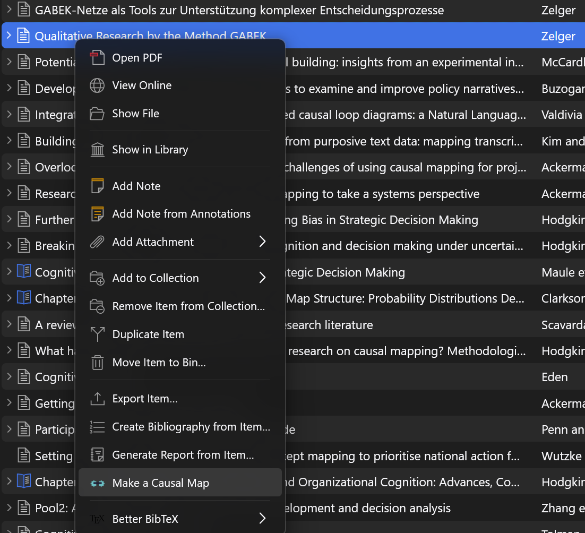
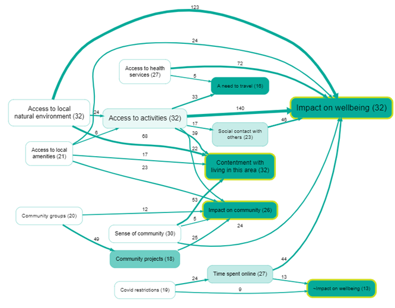

This page is for researchers who keep their reading in [Zotero](https://www.zotero.org/), the free reference manager, and want to see the causal argument of a paper without rebuilding it by hand.

**Causal Map for Zotero** is a plugin that sends a paper from your Zotero library to Causal Map, which codes it with AI and draws a causal map: each box is a factor named in the text, each arrow is a claim that one factor influences another, and every arrow keeps the quote from the paper that backs it. You then explore, filter, edit and share the map in the Causal Map web app like any other project.

## Install

1. Download the plugin file, [causalmap-zotero.xpi](https://github.com/stevepowell99/causalmap-zotero/releases/latest/download/causalmap-zotero.xpi).
2. In Zotero, go to **Tools, Plugins**, click the gear icon, choose **Install Plugin From File** and pick the file you downloaded.
3. Restart Zotero.

It works with Zotero 7, 8 and 9. It updates itself when we release a new version. You can also install it from inside Zotero through the community Add-on Market.

## Make a map

1. Right-click an item in your library that has a PDF Zotero has read, and choose **Make a Causal Map**. If the item has more than one PDF, right-click the exact PDF you want instead.
2. A Causal Map tab opens in your browser. Sign in or sign up, then click **Approve**.
3. Causal Map imports the paper into a new project and codes it. When coding finishes, the map appears.

The new project is private to your account. From there it is an ordinary Causal Map project: see [[400 Autocoding with AI ((howto-autocoding))|Autocoding with AI]] for what the coding does and how to adjust it, and [[250 Formatting your map for what you want to show ((howto-map-formatting))|Formatting your map]] for making the map say what you want it to say.

## Good to know

- It handles one item at a time.
- The item needs a readable attachment, a PDF that Zotero has indexed. Items without any text are skipped.
- Coding uses your account's normal AI credits. A free account gets a monthly allowance of credits, enough to try it on a few papers.
- The plugin never holds your login. You approve a short-lived pairing in the browser, and the paper's text goes to Causal Map under your account, exactly as if you had uploaded the PDF yourself. So only send material you have the right to process.

The plugin's source code is on [GitHub](https://github.com/stevepowell99/causalmap-zotero).
