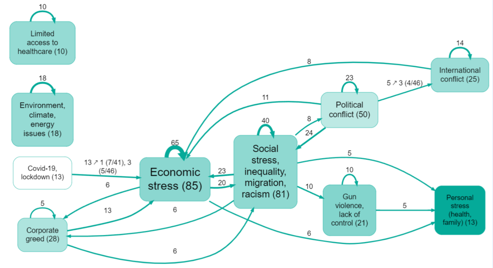

2023-09-19

_Summarised from "[An M&E time machine: Using AI to measure changes in a system across a time period on features which only emerge during it](https://doi.org/10.6084/m9.figshare.33518512)" by Steve Powell, Gabriele Caldas Cabral and Hannah Mishan (2024) [@powellMETimeMachine2024]._

## The problem{.banner}

Anyone monitoring a complex project meets the same paradox. To measure change, we need to define the key variables (outcomes, drivers, external influences) at baseline and build them into our instruments. But the variables that turn out to matter often become visible only later: the context shifts, the design changes, new outside factors intervene and unexpected outcomes become important. An open-ended, qualitative approach can find them, but only at endline, which is too late for the measurement plan. Asking people at endline to recall how things were at baseline brings recall bias and a tendency to report the change the programme theory leads them to expect.

What we need is a time machine: a way to carry a questionnaire back from the future to the baseline.

## The proposal{.banner}

Causal mapping offers a way round this. Instead of fixing variables in advance, we ask stakeholders at each time point open questions about what drives the issues they care about, and code each answer as causal claims: links from one factor to another, each tied to its source and its quote. Because the factors come from the data rather than from a codebook, we can pool all the time points, group the factors into clusters of similar meaning, and only then ask whether each factor or link was mentioned more or less often at each time point. The method runs in four steps:

- Interview stakeholders at each time point about outcomes, their causes and the causes of those causes.
- Code the transcripts for causal claims, without a codebook.
- Cluster the resulting factor labels into a smaller set of themes, across the pooled data.
- Compare how often each factor and link is mentioned at each time point.

By hand this has been too slow to use at scale: a typical 24-interview QuIP study might take a trained analyst two to three weeks to code. The study asked whether AI could do both the interviewing and the coding.

## The proof of concept{.banner}

We chose a generic topic on which almost anyone holds causal opinions: what are the main problems facing the USA, and what are their immediate and underlying causes? An AI interviewer, Qualia (formerly StorySurvey), ran short adaptive chat interviews with "Master"-level workers recruited through Amazon's MTurk. We repeated the survey in September, October and November 2023 with about 50 respondents each time, different people in each round. This is a convenience sample, so the findings say nothing about Americans in general; the point was to test the method.

The AI coder in the Causal Map app worked through the transcripts using generic, human-readable instructions that named none of the factors to look for. It found 1,024 causal links in the 136 transcripts (out of 163) that contained at least one causal claim, an average of 7.5 links per transcript. We scored every link from 0 to 2 on four precision criteria: nearly two-thirds scored full marks, and only 10% lost more than two of the eight points. Errors were scattered, with more of them where human analysts also judged a claim hard to code.

Without a codebook, the AI produced 1,205 different labels under 532 themes, many of them near-synonyms such as "Economic conditions" and "Economic issues". Automatic clustering by meaning reduced these to a readable overview map, below, showing the links mentioned by at least five sources and the ten factors mentioned by the most sources. Even with that filter, 131 of the 136 sources contribute to the map.

Overview causal map, pooled across the three rounds. Numbers on factors and links count the sources mentioning them; the annotations on two links mark significant differences between rounds.

Economic stress was mentioned by the most sources (85) and was central to most of the stories, with Covid-19 appearing purely as a driver of it. Social stress, inequality, migration and racism was the other central factor, which many respondents linked to political conflict.

## Did the time machine work?{.banner}

For each factor and link we tested whether the number of sources mentioning it differed across the three rounds (chi-squared, p < 0.05, without correction for multiple comparisons). No factor in the map differed significantly, but two links did:

- Political conflict → International conflict: five sources in all, four of them in November, out of 46 respondents that round. We relate this to the situation in Israel and Palestine at the time. One November respondent: "Our government supporting genocide because of our own economic interests in a part of the world we have no business being in."
- Covid-19, lockdown → Economic stress: seven of 41 sources in September and five of 46 in November, but only one in October, a pattern that is harder to interpret.

The first result is what the method is for: the pipeline picked up a change on a feature that nobody specified at baseline, which emerged from the interviews themselves. Over three months nothing appeared that would have surprised a visitor from the baseline. Over ten years, a repeated "causal opinion survey" of this kind could track factors such as mistrust of vaccination or denial of election results, which nobody would have thought to put in a baseline questionnaire.

## Limits{.banner}

- The interviews and coding passed through OpenAI's servers, so the approach as run here is not suitable for sensitive information; a privately hosted model would address this.
- Language models carry a dominant worldview into what they notice and how they label it, and the people most disadvantaged by that worldview have least say in how the tools are built.
- Chat interviewing probably favours some respondents over others (perhaps younger ones), cannot build rapport or support someone in distress, and does not replace face-to-face work.
- Clustering is unstable: a small change in a parameter can reorganise the clusters, and a cluster can absorb labels that do not really belong to it, inflating its apparent importance. Clusters can also merge opposites, such as "military strengthening" and "military weakening" under "International conflict".
- Causal mapping assembles evidence about what people believe influences what. It is not a method of causal inference, and it does not measure the strength of effects: there can be strong evidence for a weak link.

The pipeline still needs supervision. One changed word in the instructions can change the results, and the evaluator remains responsible for the conclusions.

## Next step{.banner}

The study used a proxy topic. The next step is to run the same pipeline over the life of a real project, tracking how outcomes, and the factors stakeholders see as driving them, change between baseline and endline.
