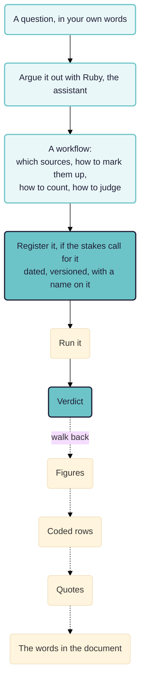

*For evaluators, commissioners and anyone else working out what evaluation analysis should look like now that AI can do much of it.*

Give a frontier model such as Claude Opus 5.5 the terms of reference and the documents from an evaluation, and in our experience it can now answer the desk-based part of most evaluation questions about as well and as accurately as a competent evaluator, in minutes. The models get better every month. So how do evaluators, and the people they work with, stay the pilots rather than the passengers? Who chooses the method, whose standard decides what counts as good, and how can anybody else check what was done? The politics and ethics of that matter, and so do guidelines, but this chapter is about things that run.

> **Work in progress.** None of what follows has yet been used on a live evaluation. The pages are drafts, published early so people can argue with them.

What we have so far comes in four parts, each up for discussion.

## A principle: reconstructible reporting

Any evaluation report based on an analysis of text could come with a bundle holding the data and the instructions somebody else would need to rebuild the analysis and reach comparable, though probably not identical, results. The principle is a familiar one. It takes on new life now, because a frontier AI can carry out that kind of rebuild with little effort, so a commissioner no longer has to take the method on trust. It applies to analysis done by people, or by people working with AI, as much as to analysis done by AI alone. In its present form the principle says too little about the participatory stages of an evaluation, and about the versions of a report that go back and forth with stakeholders.

## An open format for the bundle

[[003 An open format for reconstructible reporting ((open-format))]] proposes a published specification for that bundle, with a small set of auditable steps from which an analysis is built, whether people or AI carry them out: choose documents, mark passages, group them into themes, count, judge against a rubric, write. Fuller approaches such as contribution analysis can be put together from them. The format is at version 0.3. Nobody needs to agree on one format, and we expect several overlapping ones to appear and to keep changing. [[007 Is there already a standard qq ((rubicon-standards))|Is there already a standard?]] reports what we found when we looked for an existing one.

## Rubicon for Claude: a free, open-source plugin

[Rubicon for Claude](https://rubicon.causalmap.app/plugin) is a plugin that makes your own Claude work to a more explicit method that somebody else can rebuild. Claude is left to reason however it likes, then has to write down the workflow it followed, and the report is rebuilt from that workflow: every count is made by code, every quotation is found word for word in its document, and a zip goes with the report from which somebody else can recreate it. The aim is a Claude as adaptable as the plain one, but more accurate and open to audit; in our tests so far it is more accurate than plain Claude. It costs nothing beyond a Claude subscription, and the code is on [GitHub](https://github.com/stevepowell99/causalmap-plugins) under the MIT licence. An MCP server offering the same tools to other assistants is in development. How to install it, and example reports, are on the [Get page](https://rubicon.causalmap.app/plugin).

## The Rubicon app

A web app for the same job, still in development, with more support for the evaluator. You bring a question about a project's documents to Ruby, the app's assistant, who settles the question with you and proposes a plan in plain words, with its cost, before any analysis runs. On your go she carries it out, and every figure in the result leads back to a passage somebody can read. The app reads Causal Map projects and uses the Causal Map login. It is not finished, not priced and not yet generally available.

The walk back is the test. If it breaks anywhere, nothing else about the run counts.

[[005 Rubicon principles ((rubicon-principles))]] sets out in full the principles the plugin and the app both work to: who declares what counts as good, why every claim points at a quote, what a finding is compared against, what to say about what was not read, and what Rubicon refuses to do.

## Worked examples

Working papers that put Rubicon to particular evaluation methods, some with runs to report.

- [[008 Theory-based evaluation ((theory-based))]]: what commissioners want when they ask for a theory-based evaluation, and a run that hangs the evidence on each link of a theory of change.
- [[030 Contribution analysis ((contribution))]]: a programme's own theory of change put link by link to a select committee's evidence, with a blind check of what the write-up got wrong.
- [[010 Testing rival theories ((theory-fit))|Testing rival theories over a corpus]]: five published explanations of loneliness, and a design for asking which of them fifty interviews support.
- [[020 Realist mechanisms ((realist-mechanisms))|Generating realist mechanisms]]: generating mechanisms from a corpus, with a control for the ones anybody could have written without it.
- [[040 Outcome harvesting ((outcome-harvesting))]]: which parts of an outcome harvest a machine should touch at all, and a draft outcomes table for a workshop to argue with.

The method papers fit together. The realist paper generates candidate explanations, the theory-fit paper tests rival ones on material that played no part in producing them, and the contribution analysis paper does the same job for a theory somebody has already committed to in writing. Theory-based evaluation is the family all three belong to. Outcome harvesting sits apart, because most of that method is a conversation between people.

## How this relates to causal mapping

Rubicon is not causal mapping and does not replace it. How the two products relate is in the [Rubicon FAQ](https://rubicon.causalmap.app/faq). How the two methods relate is below.

- Causal mapping builds one model of what people say causes what. See [[005 Minimalist coding for causal mapping ((minimalist))]] for the coding style and [[203 Task 3 -- Analysing data, Answering questions ((task3-analysing))]] for what you do with the result.
- Rubicon answers one stated question at a time, with a standard fixed in advance. A project holds as many codings as it has questions.
- The two meet on evidence. [[902 Quality assurance at each step of the causal coding workflow ((quality-assurance))]] sets out how we check causal coding, and [[705 Ways to causal inference ((ways-to-inference))]] places process tracing and its neighbours among the other routes to a causal claim.
- [[900 A simple measure of the goodness of fit of a causal theory to a text corpus ((goodness-of-fit))]] measures fit a different way, by asking how much of a coded map a theory's own vocabulary can express. Coverage rewards breadth; the diagnostic tests in the theory-fit paper reward discrimination. Running both and reporting where they disagree is more informative than either alone.
- [[0133 Causal mapping differs from related approaches - epistemic, less predictive, unsophisticated, many links, many sources, unclear boundaries ((differs-from-related))]] explains why causal mapping takes many links from many sources where process tracing takes few links very seriously. Rubicon is an attempt to get some of the second at the scale of the first.

## Whose work this builds on

- **Process tracing.** The four evidence tests are Van Evera's, restated by David Collier. Derek Beach and Rasmus Brun Pedersen supply the account of a mechanism as entities engaging in activities, and the within-case discipline the corpus work has to depart from. Tasha Fairfield and Andrew Charman argue that confirmation is a matter of degree rather than of type, which is the warrant for treating a test result as graded.
- **Bayesian process tracing in evaluation.** Barbara Befani and John Mayne combined process tracing with contribution analysis; Barbara Befani and Gavin Stedman-Bryce named the result Contribution Tracing. Their method asks an analyst to estimate how likely evidence would be if the hypothesis were false, and our theory-fit paper argues that quantity could be measured on synthetic material instead of elicited. That is either a useful shortcut or a category error.
- **Taking process tracing past one case.** Derek Beach, Gabriela Camacho and Markus Siewert's Comparative Process Tracing is the nearest existing work to what we are attempting.
- **Realist evaluation.** Ray Pawson and Nick Tilley for the framework, Nick Emmel and colleagues and Sonia Dalkin and colleagues for the resource-plus-reasoning reading of a mechanism, and Robert Merton behind the requirement that a configuration instantiate something more general.
- **Contribution analysis** is John Mayne's, and **outcome harvesting** Ricardo Wilson-Grau's. **Qualitative comparative analysis** is Charles Ragin's. **Evaluative rubrics** are E. Jane Davidson's, Julian King's and Judy Oakden's, and Julian King's objection that AI should not be making evaluative judgements about human affairs is one we accept: nothing inside a scale makes it evaluative, so the standard has to come first, from somebody who put their name to it.
- **Quality of evidence rubrics** are Thomas Aston and Marina Apgar's.

**We would like to work with people on this.** If any of the above is your field and the argument looks wrong, or looks right and worth building on, we would rather hear it now than after we have published a result. Steve Powell, Causal Map Ltd, Bath: hello@causalmap.app.

*This page was drafted with the assistance of Claude, an AI model from Anthropic; the arguments and judgements are our own.*
