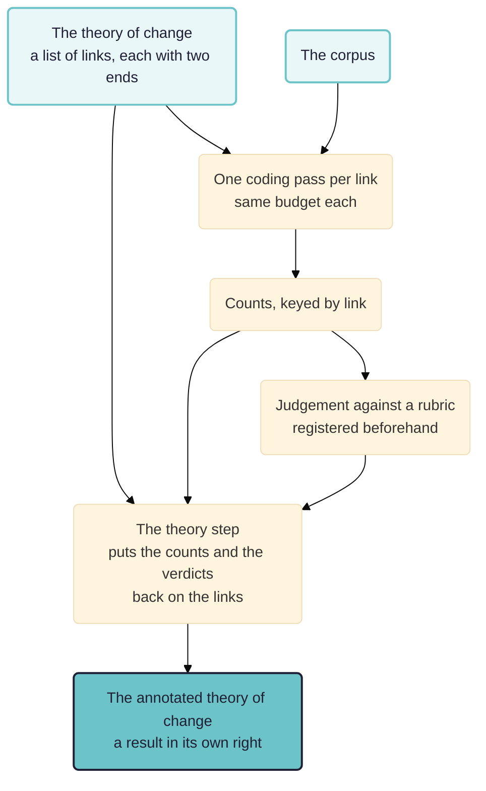

Theory-based evaluation is the family that the other method papers in this chapter belong to. Contribution analysis, realist evaluation and process tracing each state a theory in advance and then test it against the material. Commissioners ask for this in general terms far more often than they ask for any one of these methods by name. This paper is about the form the result takes, and reports one run.

> **Work in progress.** We have run Rubicon's theory-of-change step on the app's own example project but not yet on an evaluation. Every figure below comes from that run. Comments welcome.

## Summary

An evaluator who drew a theory of change as a diagram wants the answer as a diagram too.

- **The papers in this chapter are members of the family.** [[030 Contribution analysis ((contribution))]] starts from the theory the programme committed to, and [[020 Realist mechanisms ((realist-mechanisms))]] builds one where none has been written yet. [[010 Testing rival theories ((theory-fit))]] decides between several. In each, the evaluator writes the theory down before reading the material.
- **Testing a theory produces a table.** Coding once per link gives counts listed by link, and the branch structure the evaluator drew is lost.
- **A `theory` step puts the links back into the diagram.** The step adds no content of its own. The structure comes from the list of links declared in the workflow, the numbers from the counting step and the verdicts from the judging step.
- **The run.** Eight links and nineteen household interviews gave 590 coded passages. In the diagram, two branches of the theory converge on wellbeing; the table did not show this.
- **Limits.** We did not hold out half the material or build a synthetic contrast set. The step gives a verdict for a link only where a rubric criterion was named after that link.

See also: [[000 Pilots, not passengers -- reconstructible reporting in evaluation ((rubicon))]]; [[005 Principles for reconstructible analysis in the age of AI ((principles))]]; [[900 A simple measure of the goodness of fit of a causal theory to a text corpus ((goodness-of-fit))]].

**Intended audience:** evaluators asked for a theory-based evaluation without being told which kind. They have a theory of change and a set of documents, and have to show the result to the people who drew the theory.

## What commissioners ask for

Terms of reference ask for a "theory-based" evaluation far more often than for "contribution analysis" or "realist evaluation", and usually do not say which kind. Commissioners who leave the method open are not being careless. They want what the methods have in common, and are not concerned with the apparatus of any one of them. There is a theory about how the programme was supposed to work. Somebody wrote it down. They want it tested against the evidence.

This chapter covers three members of the family. They differ in where the theory comes from.

- **The programme has already committed to a theory in writing.** This is contribution analysis. The theory of change is the programme's own, and arguing with it is part of the evaluator's job.
- **The theory has not been written yet.** This is retroduction in realist evaluation: the evaluator generates the theory from the material before testing anything against it.
- **Several people have written rival theories.** This is the process-tracing case, where the job is to decide between them.

All three fix the theory before anyone reads the material. That order of work is the discipline. The evaluator names and dates the theory first, so that a reader can tell a proposition that held up against the evidence from one written afterwards to fit it. Recording that order works the same way whichever method is used, so Rubicon's assistant builds each workflow from general parts and does not pick a named method from a menu.

They also share a deliverable: the theory of change, with the evidence on each link attached to that link. A programme manager can then see which parts of their own account the material supports and which parts it does not mention at all.

## The table and the diagram

Test eight propositions against nineteen documents and you get a table, one row per link, giving the number of passages relevant to the link, the number supporting it and the number contradicting it. The table is accurate. But the theory was drawn as a diagram, and the workshop that discusses the result will be looking at that diagram.

A table listed by link cannot show where two branches converge. Nor can it show that one branch has a great deal of material behind it while another has almost none, or was never examined at all. These are findings about the theory as a whole. We can only see them once the links are back in the diagram, which therefore contains information the table did not.

The theory of change is used twice: first to define what to look for, then to place what was found.

## What the theory step does

When asked to test a theory of change, Rubicon's assistant writes a `from` and a `to` beside each link's proposition, so the graph is already in the workflow. The `theory` step reads that list, the counts and any verdicts, and saves the assembled graph as a separate result. It does not call a model or cite anything itself. Every number on the graph comes from an earlier result, so a reader traces a link back to its passages by the route that already existed: from link to figure, figure to coded row, row to quote, and quote to the words in the document. Because the list of links is written once, in the workflow, the diagram shows exactly the links that were coded.

The step refuses to draw in three cases where the diagram would be wrong in ways a reader could not see.

- **A link with one end missing.** A theory of change is a graph, and an arrow that points nowhere does not count as an arrow.
- **A list of links that does not exist**, or a step that did not test one link per pass.
- **A theory with no results attached.** With neither a table nor a judgement, the diagram would only repeat the workflow.

The step distinguishes absent from nought. If no figure covered a link, that does not mean the material has nothing on it. So the step stores an uncounted link as empty, with a flag saying which of the two cases applies. This is the distinction a drawing is most likely to lose. An evaluator cannot recover it from anywhere else.

The diagram also has to keep three findings apart: supported, contradicted, and addressed by nobody. For why the third matters, and why it usually means that nobody examined the link (which is different from finding it unsupported), see [[030 Contribution analysis ((contribution))|the contribution analysis paper]]. If a diagram draws a faint arrow and a contradicted arrow the same way, the difference disappears without anyone noticing: both look like bad news, but they are opposite findings. A fourth reading, "counted, not judged", is for a link the run counted under a figure name the step does not recognise. The diagram may then report that it cannot tell what the material concluded. It may not report that nobody looked.

## The run

We ran the workflow on 6 September 2026 against the app's own example project: nineteen anonymised household interview transcripts from two provinces. The theory of change has eight links, from training through farming and health knowledge to wellbeing.

The coding covered all eight links in all nineteen documents and produced **590 coded passages**. Each quotation was then located in its document; 588 matched exactly and two matched with a gap. Every one of the nineteen documents is quoted somewhere in the result. The coding cost $4.05. The run reported here reused it and cost nothing.

Per link, the count of supporting passages ranges from 56 on each of the two training links to 100 on "better health practices lead to improved family health". The two health links are the best evidenced of the eight, at 94 and 100, against 73 for the next highest. All eight links were counted, and none came back empty.

The assembled graph has eight factors and eight annotated links, and **two branches converge on wellbeing**, one through better nutrition and one through improved family health. A table listed by link could not have shown this. It affects how we read the result: a weak link in one branch matters less when the other branch reaches the same outcome.

The judgement gave one verdict for the whole theory, fully supported, against a rubric with a single criterion: that all eight links have at least two supporting sources. With 572 supporting passages that is easily met, so the verdict adds almost no information. The useful result is the link-by-link annotation; the rubric is only a coarse first check.

The run raised two problems that apply more widely.

- **A figure's name can be wrong.** The per-link figure was called `supporting-sources-count`, but it counted passages: its eight values sum to 572 over a corpus of nineteen documents. Whoever writes the workflow names the figures. An annotated diagram prints each name next to its arrow, which is where a reader is most likely to spot a wrong one.
- **A diagram can report a negative finding the evidence does not support.** In the first version, the step chose a link's colour by looking for four particular figure names. This workflow did not use any of them, so every count read as zero and the diagram drew all eight links as addressed by nobody, despite 572 supporting passages. Telling a programme manager that nobody looked at a link the run did count is worse than telling them nothing, because they would act on it. The step now treats a counted link as addressed, whatever its figures are called.

## Limitations

- **We did not hold out half the corpus or build a synthetic contrast set.** We tested a theory against a corpus and reported the result. We have not shown that the same workflow would have given a different answer if the theory had been wrong.
- **The step gives a per-link verdict only where a rubric criterion was named after a link**, because the record does not connect criteria to links in any other way. Here the rubric had a single criterion covering the whole theory, so the colour of each link comes from the counts alone.
- **The counts are of passages.** A workflow has to say so if it wants counts of people or documents.
- **The step does not judge worth.** A theory of change can be well evidenced on every link and still describe something not worth doing. Judging that needs a rubric that somebody has registered and put their name to.
- **We have one run, on an example project.** The step has not yet been used in an evaluation.

## Next steps

- Run the step on a real theory of change, with rubric criteria named after the links, so that per-link verdicts appear and the annotation shows what was judged as well as what was counted.
- Include a contradicted link and an unaddressed link in the same run on purpose, to check that the diagram does keep the three findings apart.
- Show the whole-outcome rival pass from [[030 Contribution analysis ((contribution))]] on the same diagram. A theory with every link supported is still consistent with the programme having contributed nothing.

*This page was drafted with the assistance of Claude, an AI model from Anthropic; the arguments and judgements are our own.*
