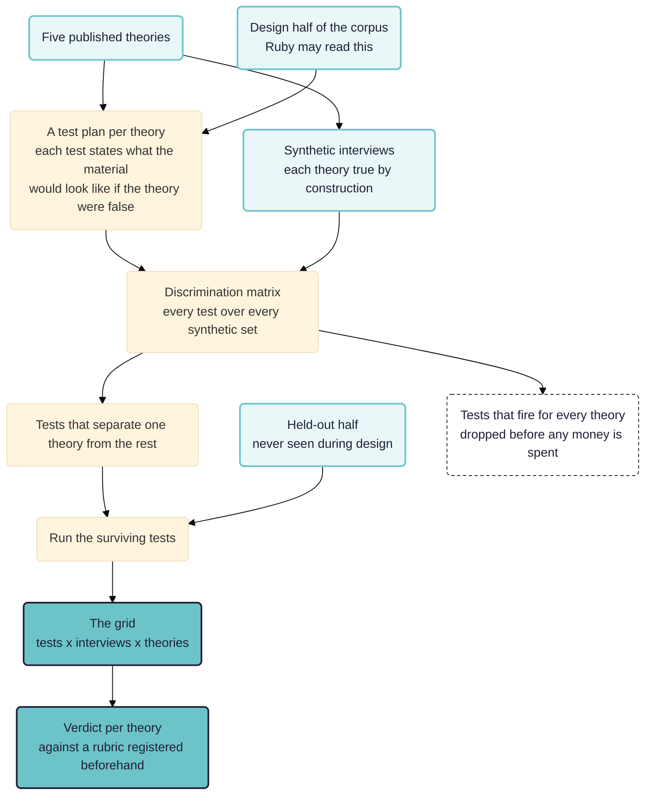

> **Work in progress.** This page sets out the design for a study. We have run one of the five theories through the workflow on the real corpus. The results are under *A first run*. We have not yet run the study itself: there is no held-out half, no synthetic contrast set and no three-arm comparison, so we do not yet know whether the method can tell theories apart. Three of the five theories still need sources. Comments welcome.

## Summary

We take five published explanations of loneliness and ask which of them a body of interviews actually supports.

- **The material.** Fifty interview files from forty-eight people aged 18 to 24, recruited to a quota across four of London's most deprived boroughs and interviewed in 2019.
- **The theories.** Five accounts from different traditions. We write each one out as a paragraph and add three variants before anybody reads an interview, so that a result does not depend on one lucky wording.
- **The tests.** We turn each account into a set of diagnostic tests of process tracing's four types: straw-in-the-wind, hoop, smoking gun and doubly decisive. Each test states what the material would look like if the account were wrong. We register the set before reading the corpus.
- **Discrimination measured before the real corpus.** We generate synthetic interview sets in which one account is true by construction, and run the tests over them to see which can tell the accounts apart. Any test that fires on every set is dropped.
- **A split corpus.** We write the tests against a design half of the corpus and run them against a held-out half, so no test is scored on the material it was written from.
- **The output.** A table showing which account fits which people, since different accounts may be right about different people. Every figure can be traced through the coded rows and quotes to the words in the transcript.

See also: [[020 Realist mechanisms ((realist-mechanisms))|Generating realist mechanisms]], which generates mechanisms without starting from a theory, whereas this page tests theories other people have published; [[000 Working Papers ((working-papers))]]; [[900 A simple measure of the goodness of fit of a causal theory to a text corpus ((goodness-of-fit))]]; [[902 Quality assurance at each step of the causal coding workflow ((quality-assurance))]]; [[986 Causal mapping of loneliness interviews ((lonely-causal2))]].

**Intended audience:** evaluators and applied researchers who want to know whether a theory of change, a programme logic or a published explanation is borne out by narrative evidence, with the test written down before anybody sees how it comes out. This is not a causal mapping study.

**Contribution.** These parts of the design may be new, as far as the search reported below found:

- **Measuring a test's discriminating power in text**, by generating synthetic interviews in which each theory is true by construction. Befani, Elsenbroich and Badham have already proposed producing these probabilities by social simulation, as a third option alongside expert elicitation and empirical frequencies [@befaniDiagnosticEvaluationSimulated2021]. What we add is the domain and the instrument. Their simulation models a system, whereas we generate documents.
- **Aggregating a test result across a corpus by counting**, where Comparative Process Tracing aggregates by eliminating or bounding scope conditions [@beachGoingBeyondSingle2022].
- **Sorting each part of each theory by whether a respondent could be expected to report it**, and writing that part's tests at that level.

We take the following from earlier work unchanged: pre-registering the tests, already published practice in evaluation as Contribution Tracing [@befaniProcessTracingBayesian2017]; treating a hoop result as a matter of degree, which Fairfield and Charman proposed first [@fairfieldExplicitBayesianAnalysis2017]; holding out half the corpus; and the four evidence tests, which are Van Evera's, as restated by Collier [@collierUnderstandingProcessTracing2011].

Ruby, Rubicon's assistant, reads the design half while writing the tests and never sees the held-out half. We compute the verdict only on the held-out half, which played no part in writing the tests.

## The question

Suppose you have fifty interviews with young people about loneliness, and five published accounts of why young people are lonely. All five are respectable and each can be stated in a paragraph. Which one does the material support?

The obvious approach is to give a model the corpus and the five paragraphs and ask. You get a fluent answer with a few well-chosen quotations. It states no standard. A reader has no way to disagree with any particular part of it. A model asked "which of these fits?" might also say that all of them do, since each of these theories is compatible with almost anything a lonely person might say.

Our task is to turn "does this theory fit?" into questions that could come out either way. We write them down before reading the material, and fix in advance a rule for combining their answers into a verdict.

## Why an evaluator should care

In evaluation the same problem appears as the question **is the theory of change borne out?**

By the theory of change we mean the one or two central mechanisms a programme depends on, stated at a level where one part of a mechanism could fail on its own. A logframe with forty nodes and a hundred arrows is too large to test. Nobody tries. Three examples, each with the clause that makes it testable:

- A cash transfer paid to the woman instead of the household head changes **who is in the room when a spending decision is made**, and the change in who is present is what gives her more say. The rival says the extra money alone does it, in which case paying either partner would work as well.
- Putting researchers and civil servants in a room produces **a relationship that outlives the meeting**, and the relationship is why the evidence gets used later. The rival says the convening improves the evidence itself, making it better or more accessible, in which case a good report posted to the same people would have the same effect.
- A community space reduces isolation because it gives people **a reason to be there other than wanting company**, so people can form ties without anybody having to admit to being lonely. The rival says the hours and the location are what matter, in which case any open room in the right place would do.

Each of these could be false. Each also says what the material would show if the rival were right instead. That part is almost never written into a theory of change.

Contribution analysis [@mayneMakingCausalClaims2012] and process tracing [@collierUnderstandingProcessTracing2011; @befaniProcessTracingBayesian2017] were designed for a few cases and a great deal of analyst time. With the loneliness study we rehearse the approach on fifty transcripts, where the theories are already published and nobody is paying us to reach a particular answer.

## The material

The corpus is the one behind our earlier loneliness papers: fifty interview files from forty-eight participants aged 18 to 24, recruited to a quota across four of London's most deprived boroughs, interviewed in the summer of 2019 [@fardghassemiQualitativeOutputData2022]. The interviews average about nine thousand words. Sex, age and borough are recorded, so we can stratify. Two participants' second interviews are in separate files, so every proportion has a base of fifty, or forty-eight if we merge those files first.

Two features of the corpus affect the design.

- **The interviews predate the pandemic and the rise of TikTok.** An account built on a recent change in platform use would be tested on a period before that change. Its tests must not rely on material the corpus could not contain.
- **The interview opened with a free-association task about "the experience of loneliness".** That framing may give respondents the vocabulary of shortfall and comparison. A theory predicting that people describe loneliness as a gap between what they want and what they have is then partly predicting the interview schedule. We have to write its tests so that the schedule's own words do not count as evidence.

## Five theories

We chose five accounts from different traditions. They make different predictions, and none restates another. Each is given here in roughly the paragraph Ruby would receive. For the hypervigilance and attachment accounts we also give sources and a note on how each stands in the current literature; the discrepancy, political economy and displacement accounts still need citations.

**The hypervigilance loop.** Loneliness is an aversive signal, like hunger, that evolved to push a social animal back towards the group. When it persists it becomes self-reinforcing: the lonely person becomes watchful for social threat, reads ambiguous behaviour as rejection, and pulls back or guards themselves in ways that produce the coolness they feared. On this account the mechanism is a loop inside the person. It does not depend on a shortage of people. Cacioppo and Hawkley describe loneliness as an evolved signal (2009, *Trends in Cognitive Sciences* 13(10): 447-454); Hawkley and Cacioppo set out the loop (2010, *Annals of Behavioral Medicine* 40(2): 218-227).

*Standing: the theory is mainstream; the hypervigilance part is contested.* Spithoven, Bijttebier and Goossens (2017, *Clinical Psychology Review* 58: 97-114) conclude that lonely people show "an increased attention for social threatening stimuli", but theirs is a narrative review and does not pool effect sizes. The study that best matches the claim is by Bangee and colleagues (2014, *Personality and Individual Differences* 63: 16-23), who eye-tracked 85 UK undergraduates aged 17 to 19. They found the effect only in the top quartile of loneliness and only in the first two seconds. Across the extended viewing period after that it was absent.

**Two lonelinesses.** Emotional loneliness is the lack of a particular attachment figure, and company does not relieve it. Social loneliness, the lack of a network, is not relieved by intimacy. The source is Weiss (1973, *Loneliness: The Experience of Emotional and Social Isolation*, MIT Press); the standard measure is de Jong Gierveld and Van Tilburg's six-item scale (2006, *Research on Aging* 28(5): 582-598).

*Standing: partly supported; the number of dimensions is unresolved.* Russell and colleagues (1984, *Journal of Personality and Social Psychology* 46(6): 1313-1321) found that the two forms could be told apart but shared "a common core of experiences". Van Tilburg (2021, *The Gerontologist* 61(7): e335-e344), analysing data collected with the scale, found five factors instead of two. A study that treated the distinction as settled would overstate it.

**The discrepancy is with the expected.** Loneliness is the gap between the social life someone wants and the one they have, so the amount of contact does not predict it on its own. What has changed is the standard people compare themselves against. It used to be the street; now it is everyone's edited evening.

**Loneliness is manufactured.** Loneliness is a product of how social life is organised: hours that make regular company impossible, rents that force people away from everyone they know, the closure of the places people used to meet for nothing, and platforms that sell connection back as a product. It is not a private failure.

**Displacement.** Time and attention that used to go on face-to-face interaction now go on mediated interaction, which does not meet the same needs. On the rival account in the same tradition, stimulation, online interaction adds to existing friendships instead of replacing them.

## Can a respondent report the mechanism?

If a test asks whether respondents describe a mechanism, we are assuming that a respondent could describe it. The five accounts differ on this as part of their doctrine. So before writing any test we sort each part of each theory into one of three levels.

- **Avowable.** The respondent is aware of the mechanism and can put it into words. The test can look for it fairly directly, and a passage where the respondent says it counts as evidence.
- **Not avowed, still traceable.** The respondent cannot report the mechanism, but it shows up in what they mention in passing, what they treat as unremarkable background, the order they put things in, and what they do not think needs explaining. We write the test to look for these traces. It must never require the speaker to have made the connection.
- **Out of reach of this instrument.** Nothing a respondent says in an interview of this kind could be evidence for it. A test written at this level only measures whether the speaker has come across the theory. We declare such parts out of scope instead of writing poor tests for them.

Applied to the five theories:

- **Attachment** is avowable throughout. People do say that they have plenty of friends and still miss one particular person, so an interview is close to the ideal instrument for testing it. That advantage comes from the method. It favours this theory whether or not the theory is right.
- **Discrepancy** is avowable, with the added risk that the interview schedule gives respondents its vocabulary.
- **Hypervigilance** is avowable for the reading, traceable for the loop, and out of reach for the mechanism as its own literature measures it. People can report having read a silence as rejection. They cannot report the loop, because it is the loop that makes the reading feel like perception and not interpretation. The attentional bias itself, as Bangee and colleagues measure it, is an orienting effect in the first two seconds of looking at an image, found in the top quartile of loneliness. An interview cannot provide evidence of a two-second eye movement. A test asking respondents to describe their own vigilance therefore tests a folk version of the theory. We have to say which of the two we are examining. This finding changed the design more than anything else in the literature search. We found it by searching for the theory's current standing instead of its statement.
- **Political economy** is traceable, by its own doctrine. On this theory, people cannot see the arrangement from inside it, and they experience a structural condition as a personal failing. A hoop test requiring respondents to name material constraint as a cause would be rigged against a theory that predicts they will not. So its tests look for traces instead: shift patterns, rent, commuting, moving for work, having nowhere free to sit, all mentioned as background circumstance without the speaker connecting them. Whether platforms extract sociality as unpaid labour is out of reach of a 2019 interview about loneliness. We mark that part out of scope.
- **Displacement** is avowable for the substitution and out of reach for the causal claim. Respondents describe the swap readily, but they cannot know whether it caused their loneliness. What we can trace is whether, in a respondent's account, the loneliness follows a change in device use or a change in circumstances.

The rule we follow: **for each theory, state the level of each part before writing its tests, and write each test at the level of its part.** If we ignored this, the theories most flattering to introspection would fit best, which would tell us about interviews and nothing about loneliness. The rule also means we state, before seeing any results, which parts of which theories this corpus could never test.

## Process tracing over a corpus

Beach and Pedersen sort evidence on two properties. **Certainty** is how sure we are the evidence would be found if the hypothesis is true. **Uniqueness** is how unlikely the evidence would be if the hypothesis is false. Low on both gives a straw in the wind. High uniqueness with low certainty gives a smoking gun. High certainty with low uniqueness gives a hoop test. Both high gives a doubly decisive test; these are rare, especially in interview material. (Rubicon's workflows already use a column called `certainty` for how sure the *speaker* sounds, so on this page we call the process-tracing pair **expectedness** and **uniqueness**.)

Uniqueness, i.e. what you would expect to see if the hypothesis were false, is what turns a search into a test. A test's whole power to discriminate between accounts comes from it. Informal descriptions of a method tend to leave it out. If the evidence is as likely under every rival account, the test tells you nothing, however often it fires.

Running the tests over fifty accounts instead of one case changes two things.

- **A hoop test stops being a gate and gives a proportion.** In a single-case study, if evidence that must be present is missing, the hypothesis is eliminated. In interview material, a missing item means only that it did not come up in a conversation of about an hour, which is weak evidence that it does not exist. One interview failing a hoop test is noise; nineteen out of twenty failing it is a finding. So we report a hoop test's result as the share of units where it fires, and write the threshold into the rubric in advance.
- **We expect equifinality**, i.e. different accounts being right about different people, so the useful output is a table showing which account fits whom. If a theory fits twelve accounts strongly and thirty-eight not at all, "it came second" would misdescribe a real result.

## Related work in process tracing

**We depart from Collier's gate.** His hoop cell reads: "Passing: Affirms relevance of hypothesis, but does not confirm it. Failing: Eliminates hypothesis" [@collierUnderstandingProcessTracing2011]. Collier himself calls the typology a useful heuristic that "should not be taken rigidly", so our departure is smaller than it may look.

**Fairfield and Charman have already challenged the gate.** They regard the four named tests as unnecessary inside a Bayesian framework, on the grounds that "evidentiary confirmation is always a matter of degree, not type" [@fairfieldExplicitBayesianAnalysis2017]. We keep the four names because an evaluator can work with them, even though the underlying quantity is continuous. Two of Fairfield and Charman's requirements apply directly to this design.

- **Rivals must be concrete, specified in advance and mutually exclusive.** Our five theories are concrete and specified in advance, but they are not mutually exclusive. The discrepancy account is arguably a mechanism inside the hypervigilance account, so a passage can support both. We therefore report the overlap and do not name a winner. We make that choice before the run.
- **Testimonial evidence should be recorded as "source S stated X", and never simply as X.** Recorded this way, a silence in an interview is a fact only about the interview. That is why a failed hoop test on one transcript proves so little. Fairfield and Charman do not say how to combine such likelihoods across fifty transcripts. We are working in that gap.

**Evaluators already use Bayesian process tracing.** Befani and Mayne combined it with contribution analysis [@befaniProcessTracingContribution2014], and Befani and Stedman-Bryce named the result Contribution Tracing [@befaniProcessTracingBayesian2017]. One of its benefits is that the evaluator writes down what evidence would count before going to look for it. In Contribution Tracing that happens before data collection. We do it before reading a corpus that already exists and that we have published on three times, which does not give the same protection. Zaks argues that Bayesian process tracing as practised "introduces more bias than it corrects for on numerous dimensions" (2021, *Political Analysis* 29(1): 58-74); we have read only the abstract.

**The closest work on going beyond the single case is Comparative Process Tracing** [@beachGoingBeyondSingle2022]. Beach, Camacho and Siewert check each further case only for whether a key empirical signature is present or absent. In structure that is close to a hoop test tallied case by case. They do not count, though: they aggregate by eliminating or bounding scope conditions. We have found nobody else counting across cases, but we have checked only against this one conference preprint and not the whole field. Their work also points us to an objection to our own design. They select cases for diversity instead of sampling them, so a proportion over their cases would mean nothing. A proportion is worth computing only over a base that represents some population. A quota sample across four boroughs gives us one.

**An open question:** is a corpus of fifty interviews fifty cases, or one case with fifty sources of evidence? We have found nothing in the literature that settles it. If it is fifty cases, a proportion is the right statistic. If it is one case, the proportion describes only the evidence base. Our best guess is that the loneliness corpus is fifty cases, while a programme evaluation with fifty stakeholder interviews is one. If so, the method transfers to evaluation less directly than we suggest at the start of this page. We will answer the question in writing before the study runs.

## What is known about letting a model do the coding

The design depends on a model finding in a transcript the evidence a test asks for. The published studies are less encouraging than their headline figures. Models can reach agreement with human coders of 0.6 to 0.8 kappa on a well-specified codebook, but that agreement does not carry over to other tasks or models. **Locating is much harder than classifying**: Balt and colleagues report 0.84 accuracy when a model classifies a segment it is handed and 0.67 when it has to find the segments itself (2025, *Frontiers in Public Health* 13:1512537). Every coding step in this design is of the second kind. **Aggregate accuracy can be high while the model fails to measure some codes at all**: in Chew and colleagues' replication the model failed hardest on exactly the codes the human coders found easiest (arXiv 2306.14924). If a theory's evidence falls under such a code, the theory loses without anyone noticing.

We take two devices from that literature. Chew and colleagues test whether a code's output can be told apart from random assignment. Their check needs no human labels, so we can use it to screen out a test before anybody sees the results. Repeated coding, which Rubicon already does with reuse turned off, gives a measure of consistency, though consistent coding can still be wrong. For any reliability figure on a rare code we will use Gwet's AC1 instead of kappa.

## Writing a test so it can fail

Each test in the plan is a record with these fields. The field saying what the material would look like if the theory were false matters most.

- **Proposition.** What the theory says should be true of this person, in one sentence. Following Beach and Pedersen, we state it as an entity doing something, so that this part can be false on its own.
- **Evidence sought.** What in an interview would show it, concretely enough that two coders would mark the same passages.
- **What the material would look like if the theory were false.** Written separately against each named rival. "Under the discrepancy account the same event is described as falling short of an expectation rather than as a signal about the self. Under the political economy account the event does not arise, because the obstacle is hours or fares."
- **Test type**, which we derive from the previous field.
- **What a failure means**, over one unit and over the corpus.

We refuse any test that leaves the falsification field empty. Without this requirement the exercise would find that all five theories fit. If the author of a test cannot say what would count against it, it is a search. We record it as one.

The falsification field is the Bayesian requirement without the arithmetic. In formal process tracing you estimate a likelihood ratio [@befaniProcessTracingBayesian2017; @befaniLettingEvidenceSpeak2020]: how likely the evidence is if the theory holds, divided by how likely it is if the theory does not. We will not ask anybody to put a number on the denominator, since nobody could justify one. We will measure it instead.

## Measuring discrimination

The [[003 An open format for reconstructible reporting ((open-format))|open format page]], under validating the workflow, describes the general idea: run a workflow over synthetic documents that should score well and badly before running it on the real material. Here we go further. For each of the five theories we write synthetic interviews in which that theory is true by construction, run all the tests over all five sets, and read the resulting matrix.

- A test that fires only on its own theory's set discriminates, and the matrix shows how strongly.
- A test that fires on all five sets is picking up something every account of loneliness implies. We drop it before the real run.
- If a theory's tests do not fire on any set, its own included, we have written them in a form the method cannot detect. The fault is in the tests. We learn nothing about the theory itself.

The matrix estimates how often the evidence appears when a theory is false. We get that estimate by making the theory false and looking, instead of asking an analyst to guess. With it we can answer the objection that a theory fits everything before we spend money on the real corpus.

We generate the texts from more than the tests. A text written only to satisfy a test would use the test's own vocabulary, and the coder would find the words planted for it. We also include decoys: an interview in which somebody who is not lonely talks fluently about loneliness in general, and one in which somebody who is lonely describes it badly, in few words, without the vocabulary for it.

The synthetic interviews have a limit. A model that has read the theory writes them, so they contain what the theory's adherents would say, which is not the same as what the theory predicts a real person would say. The matrix therefore shows whether the tests can tell the theories apart as written, and nothing about whether any theory is true.

## How much of the material Ruby may read

If Ruby writes the tests from the theory paragraph alone, she will ask for evidence nobody would produce in an hour of conversation about their own life. If she writes them after reading the corpus, she will write to the corpus's own idioms, so every theory will pass.

So we split the fifty interviews in two, stratified by borough and sex, and fix and date the split before anything runs. Ruby reads the design half while writing the tests and may revise them against it as often as she likes. We compute the verdict only from the held-out half.

The split also allows a small experiment. We write three test plans for the same five theories: a blind plan from the theory paragraphs alone, a half-sighted plan from the paragraphs plus the design half, and a fully sighted plan from the paragraphs plus the whole corpus. We run all three over the held-out half. If the fully sighted plan's tests fire much more often than the others on material none of them was allowed to see, we have measured overfitting. If the blind plan's tests almost never fire, we have measured the cost of designing blind.

## Variants

Five theories that we chose are a small and biased sample of possible explanations. The winner may simply be the one we stated best. So for each theory we generate three variants. Each variant shares the theory's core commitment but differs from it in at least one prediction, and also differs from all the other theories. For each variant we write down one thing it predicts that the original does not, and one thing it predicts that each of the other four does not. If we cannot write those sentences, the variant is a paraphrase. If a variant does better than its original on the held-out half, we put the difference down to how the theory was worded, and draw no conclusion about its tradition.

## Two measures of fit that can disagree

[[900 A simple measure of the goodness of fit of a causal theory to a text corpus ((goodness-of-fit))|Coverage]] measures how much of the coded causal evidence can be expressed in a theory's own vocabulary. A theory scores well on it through **breadth**: one with capacious categories covers nearly everything, which is the problem we started from. On the diagnostic tests a theory scores well through **uniqueness**. It can pass tests no rival passes while accounting for a small fraction of what people talk about.

- High on both: the theory is well supported.
- High coverage, low uniqueness: the theory fits everything.
- Low coverage, high uniqueness: the theory explains a small part of the material well. For an evaluator this is often the more useful result.

We run both measures and report where they disagree, without trying to resolve it.

## Uneven effort, the largest risk to the study

A test counts for something only if the evidence would have been unlikely were the theory false, and "if it were false" always means "if one of the rivals were true instead". So the strength of every test depends on how carefully evidence for the rivals was searched for. It does not depend on the theory under test.

Suppose the searches are uneven. The hypervigilance tests get a careful instruction, worked examples and three passes, while the political economy tests get one thin instruction written late in the afternoon. Hypervigilance then wins on every criterion at once, because each of its tests looks unique against a rival nobody went looking for. The output would not show this. The quotes would be real and the proportions correct. Every figure could still be traced to its source. The result would be an artefact of uneven attention, and a reader checking the output in the usual way could not see it.

Rubicon can check that two codings of the same text used the same settings and read the same share of it, but it cannot yet make that check across twenty tests at once. For now we keep effort equal by construction, giving every test the same budget over the same text. We have no automatic check that it stayed equal. We must either add that check or report that we ran without it.

## The workflow

We run one workflow per theory, all on the same held-out sample, in four steps: draw the sample, run one coding pass per test over every interview, count, and judge. Each test gets its own pass, so each gets its own reading of the whole interview with the same budget. A single pass with twenty tests as twenty columns would be cheaper. But a model given twenty columns finds a few and stops.

In each coding pass the model marks every passage relevant to the proposition. For each passage it records whether it supplies what the test asked for, whether it separates the account from the named rivals or fits them equally well, and how sure the speaker sounds that what they describe happened. The counting step gives, for each test, the share of units where it fired with a separating passage, and the same share without that filter. Where the two are far apart, the test is firing on material every account predicts.

We register the rubric by name and version before the run. It has five criteria; arithmetic settles four of them, and the fifth needs a judgement.

- **Hoop survival.** In what share of the held-out units do the theory's hoop tests fire? We state the thresholds in advance.
- **Smoking gun.** Is there at least one unit where a uniqueness test fires with evidenced certainty and the passage separates this account from the rivals?
- **Discrimination.** What share of the firings separate this account from the rivals, and what share are shared with them? We report a theory whose tests fire often but rarely separate as fitting everything, whatever it scores elsewhere.
- **Reach.** For how many units does this account explain anything at all?
- **Is the material relevant?** This one is judged. Where the corpus cannot distinguish this account from a rival, the judge says so and gives no band, because readers quote a band and leave out the doubt.

Besides the verdicts, the workflow must produce the grid: twenty tests by twenty-five units by five theories, with every cell filled and every filled cell traceable to a marked passage.

## A first run

We ran a test of Weiss's two lonelinesses twice on 5 September 2026, on a copy of the loneliness corpus held in the app. That copy has fifty-one documents: the fifty interview files and a newspaper article about lobbying, which does not belong in a test of Weiss but was left in the sampling frame. We drew twenty at random with a fixed seed, coded them for the two patterns, counted, and judged the result against a standard registered before the coding began. The weakest criterion set the verdict. The two runs together cost 58 pence.

The coding found 65 passages across the twenty interviews: 61 showing emotional loneliness, three social loneliness and one both. Fifteen of the twenty people showed the emotional pattern and three the social one. The standard asked whether each pattern appears at all, and whether at least a quarter of the people read show one of them.

**The two runs gave different verdicts on identical coding.** The first said the theory was not supported and the second said it was, from the same 65 passages. The difference came from a comparison inside the app that had been matching filter values case-sensitively. One figure came back as nought, so the prevalence criterion failed on a count that was really fifteen. Between the two runs we fixed the app's engine; the workflow did not change.

For this paper the fault matters more than the verdict. A theory-fit study depends on a standard fixed in advance deciding the answer. Here a fault unrelated to the standard decided it. The run's own record would not have revealed it. We saw it only because we re-ran the test after an unrelated repair.

So the run shows only a little. The design runs end to end on real material and produces the smallest possible cell of the grid. The verdict can be traced back to the passages behind it. The run does not show anything the study is for. We tested one theory of the five, on twenty interviews read once with no held-out half. We have not yet built the synthetic sets that would show whether these tests can tell one account from another.

We do not yet know what to make of the 61 against 3. Perhaps these young Londoners overwhelmingly describe losing a particular person and seldom a wider circle, which would be a finding. Or the instruction for one pattern fires on almost anything and the instruction for the other on almost nothing, which would be an artefact. The discrimination matrix should tell us which.

## What counts as a result

We do not produce a league table. The outputs, in order of how far we would trust them:

- **The grid**, showing which accounts fit which people. This is the output most likely to last.
- **The discrimination matrix from the synthetic sets**, showing how well the tests could tell the accounts apart. It is useful even if the real run never happens.
- **The three-arm comparison** of blind, half-sighted and fully sighted test design. It is a finding about the method, so it applies to every study run this way.
- **Per-theory verdicts**, last, and qualified because the theories are not independent: a passage supporting the discrepancy account often supports the hypervigilance account too. We report the overlap without netting it off.

## Weaknesses not yet addressed

- **There is no placebo theory.** All our safeguards are aimed at the tests; we have no check on the apparatus as a whole. A sixth account, written to be vacuous but plausible and run alongside the five, would show whether the method rewards any fluent story.
- **The number of tests per theory is uncontrolled.** A theory with six tests has more chances of a firing than one with three. We could fix the count per theory, or report a rate with the count as its base.
- **Firing and separating are judged in the same call.** A model that has decided a passage supports the theory will tend to call it separating. Two passes, or a second model rating uniqueness on the passages the first marked, would avoid this and would also give an agreement figure we could report.
- **We have set no minimum difference worth interpreting.** With twenty-five units, twelve and fifteen are not different, but a reader of a table of proportions will treat them as though they were. We should state the threshold before the run and print it on the grid.
- **We have not measured the run-to-run reliability of the tests**, and every other result depends on it. If two runs of the same test disagree more than the theories differ from each other, none of the verdicts means anything.
- **We have read the held-out half.** We chose these five theories after publishing on this corpus three times. Splitting the corpus cannot undo that. We can say so, or ask somebody outside the project to choose the theories.
- **Interviewer turns are not excluded.** A test can fire on a passage because the interviewer introduced the idea. The free-association opening makes that likely for the discrepancy account in particular.
- **We assert the overlap between accounts but have not measured it.** If one account fits twelve people and another eleven, a reader will ask whether they are the same people. We should declare the overlap statistic before the run, instead of computing one afterwards on a result already seen.

## What this study does not cover

- **No Bayesian arithmetic.** We use no priors, posterior odds or elicited likelihoods. We keep the concept. The synthetic contrast sets give us an estimate of the one quantity that would have mattered.
- **No claim about loneliness.** Fifty interviews from four London boroughs in 2019 do not support any general claim about young people. We are testing whether the method can tell theories apart.
- **The literature search is unfinished.** Three of the five accounts still need sources, as does the UK evidence on how lonely young adults are. We do not yet know whether anybody has already generated documents in which a theory is true by construction to measure whether a method can discriminate. Our claim that measuring discriminating power this way is new depends on the answer.

## Where the people go

- **Choosing the five theories** is a judgement about the field. It is the first place where somebody else should be involved.
- **Reading the first test plan** before it runs. Somebody who knows the material should say which tests ask for evidence nobody would ever produce in an interview.
- **Reading the grid together.** We made the grid the main output so that a group can argue over it.

We can revise the tests against the design half as often as we like because the held-out half stays unseen. The [[003 An open format for reconstructible reporting ((open-format))|open format page]], under pre-registering the workflow, describes how we record revisions to a registered plan.

## Next steps

- Build the synthetic contrast sets and run the discrimination matrix first. It is the cheapest step and the one most likely to change the design.
- Settle in writing whether fifty interviews are fifty cases or one case with fifty sources, and whether to reduce the five theories to propositions that really do exclude one another.
- Write the variants, three per theory, before anybody reads an interview.
- Only then write the test plans, in three arms, and run them over the held-out half.
- If you know of work that generates documents with a theory true by construction, or a peer-reviewed version of Comparative Process Tracing, we would like to hear from you.

*This page was drafted with the assistance of Claude, an AI model from Anthropic; the arguments and judgements are our own.*
