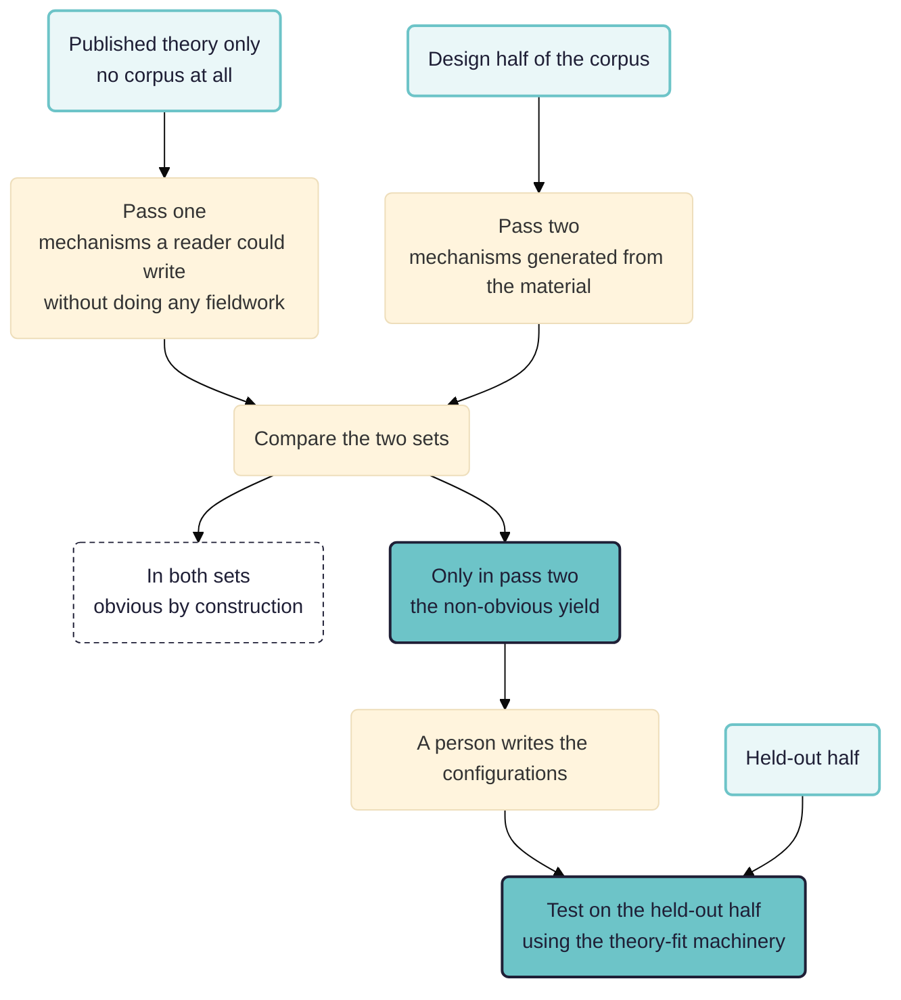

> **Work in progress.** This is a design sketch. We have written the workflows and validated them against the engine, but we have not run them, so there are no results to report. Parts of the literature search are still to do. Comments welcome.

## Summary

This paper is the mirror image of the theory-fit paper. We start with the corpus and no theory, and try to generate realist mechanisms worth having.

- **Forced variety in generation.** We run one generation prong per tradition (social psychology, economics, stigma and identity, political economy) and one per level, from the individual to the wider system. We run one per pole: once for the outcome happening, and once for it failing among people who look as though it should have happened for them. And we run one per subset of sources.
- **An obviousness control, as a step in the procedure.** Pass one generates mechanisms from the published theory alone, without the corpus. Pass two generates them from the design half of the corpus, blind to pass one. Anything in both sets is obvious by construction. We call what only pass two produces the non-obvious yield, and report it as a fraction.
- **The coding.** We code context, reasoning and outcome in three separate passes, because a whole configuration is not found in any single passage. In the reasoning pass we record `prompted_by_interviewer` (a volunteered account is stronger evidence than one the respondent agreed to) and `first_or_second_hand` (an implementer's account of why participants responded is data about the implementer).
- **Testing.** We test the configurations that remain with the theory-fit paper's machinery, on material that played no part in producing them.
- **The playoff.** We keep a general mechanism if stating it takes less text than restating the configurations it covers, and if it predicts a configuration in a part of the corpus it was not built from.
- **Gaps.** There are no results yet. In Rubicon a configuration can be assembled inside a coding, but it cannot be accepted as an answer or drawn. Two versions of a configuration set cannot be compared. Holding material back is a convention the app does not enforce. The unit of analysis is the document; Rubicon does not count people.

In [[010 Testing rival theories ((theory-fit))|the theory-fit paper]] we take theories somebody else published and ask which of them the material supports. Here we start from the corpus alone and ask whether a machine can produce mechanisms worth having: powerful, plausible and not obvious. Of all the evaluation traditions, realist evaluation has the strongest account of what a mechanism is. On where mechanisms come from, its account is the weakest.

See also: [[000 Working Papers ((working-papers))]]; [[010 Testing rival theories ((theory-fit))|Testing rival theories over a corpus]]; [[900 A simple measure of the goodness of fit of a causal theory to a text corpus ((goodness-of-fit))]].

**Intended audience:** evaluators doing realist or theory-based work who have a pile of interviews and need configurations out of it. They may suspect that a model will hand back configurations that are fluent and true but useless.

**Contribution.** As in the theory-fit paper, we separate what may be new from what is only the way we built it.

Possibly new:

- **An obviousness control.** We generate mechanisms from the published theory alone, generate again from the material, and subtract the first set from the second. What is left is the non-obvious yield, which we can count.
- **Scoring the trade between specific and general by compression.** We keep a middle-range theory if it covers many configurations in less text than restating them would take, and if it predicts one in a part of the corpus it was not built from.
- **A three-tier access rule for generation.** What we pre-register is the procedure, since generation cannot be done blind. Pretending it can is the commonest misrepresentation in this kind of work.

Not new:

- Retroduction, with its discipline of generating several candidates and writing down what would distinguish them. That is Pawson and Tilley's. Everything here is machinery for doing it at scale.
- The resource-plus-reasoning definition of a mechanism, which is Dalkin and colleagues'.
- Middle-range theory as the standard a configuration is held to, which is Pawson's, after Merton.
- Held-out validation.

If a competent reader could have written a mechanism without the fieldwork, we do not report it as a finding, however well the material happens to support it.

## The question

Give a model fifty interviews and ask for the mechanisms. It will produce a dozen. Each will be fluent and supported by quotations that really are in the text. Almost all will be worthless, in three different ways that need different fixes.

- They will describe **activities**. "Attending the youth club reduces isolation." In that sentence nobody thinks anything; it describes a service.
- They will be **unfalsifiable**. "In supportive environments, supportive processes produce positive outcomes."
- They will be **obvious**: true and well evidenced, but already written in the programme's own theory of change, or published by somebody in 1973.

Obvious mechanisms are the hardest to deal with, because they pass every quality check. They are real and supported. A participant would recognise them. Testing them for truth will not screen them out, because they are true. They are just not worth the money.

## What a mechanism is

Most published configurations get this definition wrong. A programme's activities, such as training or a helpline, are resources. A resource on its own causes nothing.

The mechanism is what people do with the resource in their heads: the programme offered X, recipients in this situation reasoned Y about it, therefore Z. The causal power is in the reasoning. People in the same room reason differently about the same offer, which is why it produces different results among them.

Ruby (the Rubicon assistant) already applies three tests.

- **Could it have happened without anybody thinking anything?** If yes, it is an activity.
- **Does it name a response, or only a provision?** "Gained the confidence to challenge a senior colleague" is a response. "Received coaching" is a provision.
- **Would the person it describes recognise it?** If the sentence would puzzle them, it is the evaluator's theory about them.

In a configuration, context means the feature of a situation that lets the mechanism fire or stops it. Rural or urban, one borough or another, are labels for places. A configuration built on them tells you only that things differ from place to place. For each candidate feature we say how it enables or blocks the specific reasoning. If we cannot write that sentence, we treat the feature as background.

## Powerful, plausible, non-obvious

These three words sound like matters of taste. Each can be made checkable. Non-obviousness is the most interesting.

**Powerful** means it accounts for a lot of the pattern and names something that could be different. We can measure both parts: the share of units the configuration applies to at all, and whether its context feature is a switch somebody could throw. A mechanism whose context is "having been born in 1998" may explain the pattern, but a year of birth cannot be changed. If the context is "whether there is anywhere to sit that costs nothing", somebody can provide one.

**Plausible** has two separate conditions, and a mechanism must meet both. The person it describes would recognise it. And it is consistent with the whole corpus, including the passages it was not built from. Machines fail on consistency. A model will build a mechanism from eight passages and never notice a ninth that contradicts it, because it was never asked to look. So we score plausibility separately, by searching the whole corpus for the disconfirming case.

**Non-obvious** means it could not have been arrived at without the material. This is usually left to the reader's impression, but it can be measured.

## The obviousness control

We run the generator twice, on different inputs, and subtract one set from the other.

- **In pass one the model reads only the published theory**, none of the corpus: for the loneliness study, the five accounts from the theory-fit paper; for a programme evaluation, the theory of change and the programme documents. We ask for the mechanisms this theory would predict in a population like this one. The result is what a competent reader could have written without doing any fieldwork.
- **In pass two the model reads the design half of the corpus** and generates mechanisms without seeing pass one.
- **Then we compare.** Anything in both sets is obvious by construction, however well evidenced it turns out to be. What appears only in pass two is the non-obvious yield: the part of the result that needed the fieldwork.

The comparison gives a number we can report as a fraction: of the mechanisms generated from the material, how many could have been had for nothing. We expect the answer to be uncomfortable on most projects.

Matching the two sets takes judgement. For each pair, whoever does the matching asks whether the two mechanisms would make the same prediction in the same context, whatever words they use. A mechanism that appears in both sets is not false for that reason. It is confirmed and unremarkable, and we report it as such.

## Generating variance on purpose

Asked for mechanisms, a model produces variations on one idea, so we have to force variance. Some ways of forcing it work better than others.

- **Vary the tradition.** Ask for the mechanism a social psychologist would write, then an economist, then somebody working on stigma and identity, then somebody in political economy. This gives the widest spread for the least effort, because each tradition counts different things as an explanation.
- **Vary the level.** The individual's history, the household, the immediate group, the institution, the wider system. When everything in a configuration is at one level, the switch is usually at another.
- **Vary the pole.** Generate mechanisms for the outcome happening and, separately, for it failing to happen among people who look as though it should have. Realist evaluators learn most from negative cases. A model left to itself does not generate them.
- **Force rivals for one pattern.** Take a single demi-regularity and require three mechanisms that would each produce it, and that differ in what else they imply. This is retroduction's own discipline. It makes the output testable.
- **Vary the seed material.** Generate from different subsets of sources and compare what each subset produced.

Then we deduplicate, with care. Two mechanisms that look alike are often different: if they differ in the context feature that switches them, merging them loses the finding. We merge two candidates only where they would make the same prediction in every context either of them names. Every merge is recorded.

## The playoff between the specific and the general

At one extreme there is a configuration per person. It fits perfectly and reaches nobody else; it is a description in realist vocabulary. At the other extreme are a handful of general statements that fit everybody loosely and forbid nothing. Pawson requires a configuration to be an instance of something more abstract that other programmes could also instantiate. We aim for a small number of middle-range theories, each with a family of specific configurations under it.

We score the trade-off in two ways and report both.

**Compression.** We keep a general theory if stating it, plus a short context clause per configuration, takes less text than restating the configurations. If the general version needs a full restatement each time, it is only a label. The argument is an informal analogy with minimum description length (the principle that the best theory gives the shortest combined description of itself and the data). Even so, it is the most useful single question to ask of a candidate generalisation.

**Prediction into unexamined material.** This is the stronger test. A general theory built on part of the corpus should predict a specific configuration in a part that was not used to build it: name the context feature, and say what reasoning should be found where that feature is present. Then go and look. If we cannot derive even one such prediction from a general theory, it only summarises what we have already read.

The deliverable has two layers. The upper layer is a small set of middle-range theories, each with its own held-out prediction and the result of testing it. Beneath each theory are the specific configurations it covers, each with its context, its reasoning, its outcomes in respects and its own evidence.

## How much of the material Ruby may see

Testing can be done blind, which settles the question for the theory-fit paper. Generation cannot. You cannot retroduce a mechanism from an empty room. A paper claiming its mechanisms came from looking at nothing would be describing a different activity.

So we register the **procedure** in advance: how many candidates, generated from what material, at what levels and in what traditions, ranked by which criteria, with the losers kept. Once that is fixed before generation, an analyst cannot try eleven unrecorded approaches and report the one that worked.

We declare three tiers of access before anything runs.

1. **Published theory and programme documents only.** Used for the obviousness control, and read in full. In Rubicon these are background documents, which a sampling step leaves out of whatever is coded and counted.
2. **The design half of the corpus.** The analyst reads it freely and revises against it as often as they like. The mechanisms are generated from this half.
3. **The held-out half.** Never seen during generation, used only to test the configurations and the middle-range theories once they are fixed and dated.

Ruby's own method notes list a further protection for this method: **a person writes the final configurations** from the generated material, and the model's output is never registered directly. In rewriting, that person judges plausibility and puts their name to the work.

In realist evaluation, registration also has a different purpose. We built Rubicon's version trail to prove that a standard did not move, which is what process tracers need. Realist evaluators need the opposite. A configuration that came through a whole evaluation unaltered was probably never tested. For them the deliverable is the trail from initial theory to refined theory. The same rubric serves both because it is versioned, immutable and dated. It can show that nothing moved, or it can show every change, when it was made and on what evidence.

## Circularity, the main danger

A model reads the corpus and proposes mechanisms. Asked whether the corpus supports them, it says yes. It extracted the mechanisms from those passages, so finding them there measures nothing at all. We designed every part of this procedure to break that loop. The loop is strong: a study can look rigorous at every step and still be a machine agreeing with itself.

Our defences, most important first:

- **Hold material back before any generation pass**, and test on it. This is essential. At present it is only a convention, which the app does not check.
- **Have a person write the configurations**; never register the model's output directly.
- **Generate more than one candidate per pattern, and write down what would distinguish them before looking.**
- **Score plausibility in a separate pass that searches the whole corpus for the disconfirming case**, beyond the passages the mechanism came from.

## What the workflow looks like

For generation we fan out over traditions and levels. Each prong produces candidate configurations from the design half of the corpus. For testing we use the theory-fit paper's machinery unchanged. Each configuration becomes a set of tests; each test states what the material would look like if the mechanism were not operating; and we run the tests over the held-out half.

We code the three CMO elements (context, mechanism, outcome) separately, in one pass each for context features, reasoning and outcomes, each with its own role, because a whole configuration is not found in any single passage. In the reasoning pass we add two columns, both taken from Ruby's own notes.

- `prompted_by_interviewer`: a respondent who volunteered a piece of reasoning is stronger evidence than one who agreed with a suggestion. In a corpus somebody else gathered, this column is the only way to tell realist interviewing from leading questions.
- `first_or_second_hand`: an implementer's account of why participants responded is the implementer's theory, so it is data about the implementer.

## What Rubicon cannot do yet

- **A configuration is not yet a result in its own right.** This is the gap that matters most. We code context, reasoning and outcome separately. A coding can assemble them into one composite, so you can read off which context passages support which configuration. But you cannot accept the composite as the answer to a question, or draw it. This paper is the strongest case we have for making it a result of its own.
- **Version comparison is manual.** Rubicon has no report that diffs two versions of a configuration set or runs one workflow against both, which matters for a method whose deliverable is the trail between versions.
- **Held-back material is a convention.** A workflow can test a refined theory on the sources that produced it, and the output will not show that it did. The runner records which sources an earlier run read, so the app could check this.
- **The unit is a source.** A demi-regularity is a pattern across sites or people, and Rubicon counts documents.

One further limit comes from the data. Realist evaluation needs a way of interviewing that puts the emerging theory to the respondent. A corpus gathered before the theory existed does not contain any such interviews. Analysis cannot make up for that. Where an evaluation is still running, the better use of all this is the reverse of analysis: produce configurations from the material so far, then take them into the next round of interviews as the propositions to put to people.

## Where the people go

Generation is the most participatory of the three designs. We already require one human step: a person writes the final configurations from the model's output, and in rewriting them judges their plausibility.

Three more steps belong in the procedure, declared before generating.

- **Deciding which traditions to generate from.** The variance is only as wide as the list of perspectives somebody chose, so choosing that list is a substantive decision.
- **Sense-making on the candidate set.** Before anything is scored, a group reads the mechanisms and says which ring true. Their judgement is data about plausibility. It should be recorded as data, separately from any ranking.
- **Taking configurations back to the people they describe.** Realist evaluation needs interviews that put the emerging theory to respondents, which a corpus gathered beforehand cannot supply. Where the evaluation is still running, this step matters most, and an archive cannot stand in for it.

## Next steps

- Pick the corpus. With the loneliness interviews the two papers would build on each other, and the five published accounts would give the obviousness control a ready-made input. A live evaluation would be a better test of whether any of this is useful, but it would need the fieldwork loop above.
- Write the generation procedure down and date it before generating anything.
- Run the obviousness control first. It is the cheapest step and needs no corpus access beyond the published theory. If the non-obvious yield is near zero, the rest of the study is not worth running.
- Build the candidate set, forcing variance by tradition, level and pole, and keep the losers.
- Have a person write the configurations, then register them.
- Only then test, on the held-out half, using the theory-fit paper's machinery.

*This page was drafted with the assistance of Claude, an AI model from Anthropic; the arguments and judgements are our own.*
