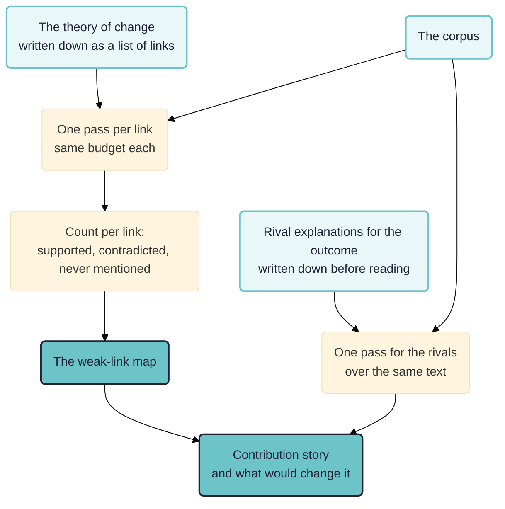

[[010 Testing rival theories ((theory-fit))|The theory-fit paper]] is about rival published theories and which of them the material supports. [[020 Realist mechanisms ((realist-mechanisms))|The realist paper]] begins without a theory and generates mechanisms. Here we begin with the theory of change the programme has already written down, and check each of its links against the evidence.

> **Work in progress.** A design, which we have tried twice on the evidence a select committee took about a proposed research funding agency. The first run failed. The second produced an annotated theory of change; a reviewer then checked its write-up against every document. Both are described under *Two runs on a select committee's evidence*.

## In short

We code the evidence against each link of the programme's own theory of change.

- **The theory of change becomes the workflow.** We write each link as a proposition with its two ends, and code each link in a pass of its own.
- **A separate pass for rivals.** In one more coding pass over the same sources we code alternative explanations of the whole outcome. Because that pass is kept apart from the link passes, a rival to the outcome can never be counted as evidence for a link.
- **Who is speaking is a column.** We code each speaker's stake, so that we can compute a second figure that leaves out the people who deliver the programme.
- **Unmentioned links are counted.** We declare the list of links in advance, so a link nobody mentioned appears in the table with a count of nought.
- **Two separate judgements.** We judge each link, which gives the annotated theory of change, and then the whole, against a rubric that says in advance how the links combine. A chain is only as strong as its weakest link, so the overall verdict is the lowest of the link verdicts.
- **What it does not do.** It does not give an attribution fraction or a counterfactual. In place of a comparison group, the rival pass records what people say about other explanations of the outcome, which is weaker evidence but better than not asking.
- **The second run.** Five of the six links came back well supported, among them the one we had most reason to doubt. A reviewer who read all 114 documents found that 18 of the write-up's 24 checkable sentences were correct and six were wrong.

See also: [[000 Pilots, not passengers -- reconstructible reporting in evaluation ((rubicon))]]; [[008 Theory-based evaluation ((theory-based))]]; [[900 A simple measure of the goodness of fit of a causal theory to a text corpus ((goodness-of-fit))]]; [[203 Task 3 -- Analysing data, Answering questions ((task3-analysing))]].

**Intended audience:** evaluators who have been asked to show that a programme contributed to a change, who have interviews and reports but no counterfactual, and whose readers are entitled to be sceptical.

## What commissioners ask contribution analysis to answer

Commissioners usually put five questions to a contribution analysis as though they were one. Most contribution analyses that go wrong do so where the question asked differs from what the method can deliver.

- **"Did our programme cause this change?"** The question as asked. Contribution analysis answers a narrower one: given the evidence, and given whatever else was going on, is there a credible account that the programme made a difference? Mayne himself writes of reduced uncertainty and plausible association.
- **"How much of the change was ours?"** Contribution analysis does not produce an attribution fraction, by design, and cannot be made to. An evaluation that reports one has stopped doing contribution analysis. Tell the commissioner so in writing at inception, or they will still be expecting a fraction when the report arrives.
- **"Would it have happened anyway?"** This is what the first question usually means underneath. A sceptical reader will press it. The only way to answer it is to treat the rival explanations as seriously as the programme's own account. Evaluators skimp on that step more often than any other.
- **"What should we fix?"** Of the five, this is the one contribution analysis answers best. Commissioners ask it least often. Once the theory of change is broken into links, with the evidence for and against each set beside it, you can see where the programme's own account is thin. A programme manager can use that more than any overall verdict.
- **"Give us something that will survive audit."** A fair request, met by the record of the work: what was claimed, on what evidence, who decided, and whether they decided before or after seeing the results.

In this paper we treat the main product of a contribution analysis as **an annotated theory of change**. It shows, for each link, whether the material supports it, contradicts it or never mentions it. We add a separate account of what else could explain the outcome. The contribution story is written around that map.



## Two kinds of rival explanation

Contribution analysis uses the word "rival" for two different things, and evaluators routinely confuse them.

- **A rival to a link.** The training did not raise referral accuracy; the new form did, and it arrived the same quarter. The rival concerns one link, and so does the evidence that would settle it.
- **A rival to the whole outcome.** The change would have happened anyway, or another agency's programme did it, or the outcome is a measurement artefact of how the indicator was defined, or the sites that improved were the ones already improving.

Teams test the first kind, because each link suggests its own alternative. Then they write the contribution story as though they had dealt with the second kind as well. They have not. Every link in a theory of change can be well evidenced while the programme contributed nothing, if whatever produced the outcome would have produced the intermediate steps too.

We therefore write down the rivals to the whole outcome before reading the material, and give them a coding pass of their own, over the same text and with the same effort as the links. We argue for the same practice in the theory-fit paper. Without it, a contribution story is not much better than a press release.

## Combining the links

Take a theory of change from A to B to C to D. The material has a great deal about A to B and D, and nothing at all about B to C. The story fails at B to C; it does not score three out of four.

Almost every contribution analysis reports as though it did, because the obvious way to summarise a table is to add it up. So we write the combination rule into the rubric in advance, and make it close to a minimum. Fixing the rule beforehand matters more here than anywhere else in these papers. An evaluator is most tempted to switch to averaging at exactly the moment one link comes back empty.

In a Rubicon rubric the rule is `combine: worst`. The overall verdict is that of the weakest criterion, judged by the order in which the author declared the verdicts, best first. Rubicon refuses a rubric that does not declare its verdicts, because the order would then be an accident of how the rubric happened to be written. The rule cannot be nested, so for a theory with several branches we write one summary per branch and combine them once.

We qualify the rule in two ways. A theory of change is rarely a single chain, and where another branch reaches the same outcome, a weak link in one branch need not sink the story. Also, a link nobody mentioned has not been contradicted, which brings us to silence.

## Links nobody mentions

Each link has one of three outcomes. The third is the one an evaluator cannot get any other way.

- **Supported**, with passages behind it.
- **Contradicted**, with passages behind it.
- **Never mentioned.** No passage has any bearing on it.

The third outcome is possible only because we give the workflow the full list of links in advance. A proposition that no passage touches then appears in the table with a count of nought. If the table were built from what the coding found, the unmentioned links would vanish from it, and the method is designed to prevent exactly that.

Silence about a link can be read in at least three ways, and the evaluator should say in the report which reading they take: the link is so obvious that nobody remarks on it; nobody was asked about it; or it did not happen. The first two are facts about the corpus and the interview schedule. Only the third is a finding about the programme. In this kind of analysis the corpus was usually gathered before the theory of change was written, and in that case the safer default is to treat silence as uninformative and record the link as unexamined (which is not the same as unsupported).

## Who is speaking

When an implementer explains why participants responded, the explanation is the implementer's theory. It tells us about the implementer. This matters more in contribution analysis than in the other methods in these papers. The people easiest to interview are those with the most interest in the contribution story being true.

We add two columns to every coding pass, both borrowed from the realist workflow.

- **First or second hand.** A programme officer's report of what a farmer felt is second-hand evidence about the farmer.
- **Prompted or volunteered.** A respondent who raised a link without being asked is stronger evidence than one who agreed when it was put to them. With a corpus somebody else gathered, this column is the only way to tell an interview that tested the theory from one that led the witness.

A third column is specific to this method: **the speaker's relation to the programme**, so that we can recompute a figure using only people with nothing to gain. If the only support for the contribution story comes from people the programme pays, we report that as the finding.

## The workflow

We write the theory of change into the workflow as a list of links, each with its two ends, and code each link in its own pass. This is the coding step for two links of a theory about convening researchers and civil servants.

```yaml
  - id: test_link
    type: code
    inputs: [sources]
    for_each:
      - id: convening-builds-relationship
        from: convening
        to: relationship
        text: >-
          putting researchers and civil servants in a room produces a working
          relationship that outlives the meeting
      - id: relationship-gets-evidence-used
        from: relationship
        to: evidence_used
        text: >-
          it is the relationship rather than the quality of the evidence that
          gets the evidence used later
    spec:
      instruction: >
        PROPOSITION: {item.text}

        Find every passage bearing on that proposition, for or against. A passage
        that describes the activity happening is not evidence that it produced
        what the proposition claims; mark that as background.
      columns:
        - name: stance
          type: category
          means: which way the passage cuts, taken at face value
          values:
            - name: supports
              means: taken at face value, it makes the proposition more likely
            - name: contradicts
              means: taken at face value, it makes the proposition less likely
            - name: background
              means: >
                describes the activity or the setting without bearing on whether
                the proposition holds
        - name: speaker_stake
          type: category
          means: what the speaker stands to gain from the proposition being true
          values:
            - name: delivers_the_programme
              means: paid by, or accountable for, the programme
            - name: receives_it
              means: a participant or intended beneficiary
            - name: neither
              means: an observer with nothing riding on the answer
        - name: prompted_by_interviewer
          type: category
          means: whether the speaker raised this or was led to it
          values:
            - name: volunteered
              means: the speaker introduced it themselves
            - name: prompted
              means: the interviewer named it first and the speaker agreed
            - name: unclear
              means: the transcript does not show which
        - name: certainty
          type: ordinal
          means: how sure the speaker sounds that what they describe happened
          levels:
            - name: speculative
              means: "imagining or generalising: would, might, people tend to"
            - name: reported
              means: stated as something that happened, without saying how they know
            - name: evidenced
              means: "particulars that show they were there: an occasion, a person, what followed"
    outputs:
      - name: link_evidence
        role: link_evidence
        type: quotes
```

The counting step collects the prongs by role, so grouping by item gives one row per link. Because the full list of links is declared in advance, a link nobody mentioned still gets its row, with a count of nought. We compute a second figure with `where: {speaker_stake: {not: delivers_the_programme}}`. It shows how much support is left once the people paid to deliver the programme are taken out.

The rival pass is an ordinary coding step over the same sources. Its instruction names the alternative explanations of the whole outcome. It has its own result. We keep it out of the link pass on purpose. These are rivals to the outcome, and to no one link in particular; if the two passes were mixed, a rival could be counted as evidence about a link.

Two judgements follow, made separately.

- **Per link**, against a rubric with the three outcomes above. This gives the annotated theory of change.
- **Overall**, against a rubric that states in advance how the links combine, how the rival explanations are weighed against the programme's account, and what would have to be true for the story to fail.

Besides the two judgements, the workflow has to produce a graph. It draws the theory of change with each link marked by what the evidence said about it, with one mark for a contradicted link and a different one for a link nobody addressed. That last mark is the easiest to lose in a picture. [[008 Theory-based evaluation ((theory-based))]] describes how Rubicon draws it.

## Two runs on a select committee's evidence

We used the evidence given to a select committee inquiry into a proposed UK research funding agency: 114 written submissions and transcripts of oral sessions, published under the Open Parliament Licence. The theory of change had six links. They led from a gap in the existing funding system, through the agency's budget and its freedom from the usual controls, to breakthroughs the existing system would not produce. Three rivals to the whole outcome were written down before any reading.

**The first run, on 5 September 2026, failed.** Ruby, Rubicon's assistant, proposed the right workflow on her second turn. She also raised two objections we make elsewhere in this paper: the sixth link cannot be evidenced from an inquiry held before the agency existed, and written submissions do not contain any questions, so nobody can code whether a point in one was volunteered or prompted. The coding step then read the material and returned 285 rows. Rubicon kept none. Every row failed the columns the step had declared, 97 of them because the model labelled a proposition `L1: existing system gap` where the column declared `L1`. The run cost $2.90. A further 26 turns of conversation, costing $2.87, never produced a workflow that would run. None of this was a problem with contribution analysis. The app was right to refuse rows labelled in a vocabulary nobody had agreed. Through the conversation that followed, the same repair kept being proposed, whatever the refusals said.

**The second run, on 15 September 2026, covered 14 of the 114 documents** and produced the annotated theory of change. Five links came back well supported, and one only partially: that freedom from the usual peer review and reporting requirements is necessary for the agency to work. Twelve of the fourteen documents were relevant to the first link, that the existing system does not fund high-risk research well. Twelve supported it with at least moderate bearing and six contradicted it. Eight of the supporting documents came from people who were not advocating for the agency.

Read the sixth link with care. It states that research funded this way produces breakthroughs the existing system would not. It came back well supported. The passages behind it are about what DARPA delivered in the United States (the internet, stealth aircraft, GPS), plus a witness's account of a British venture that had to look abroad for backing. That is argument by analogy, and by anecdote, about an agency that did not yet exist. Ruby had warned of exactly this before the first run. Our rubric did not include any criterion to separate evidence about this agency from argument about agencies like it. So a link that no corpus of this kind could settle came out looking as settled as the first. The fix is a criterion in the rubric asking what kind of evidence supports a link. That was the most useful lesson of the run.

**A blind check of the write-up.** A reviewer who had not seen the run read all 114 documents and tested every sentence of the write-up that states something about the evidence. Of 24 such sentences, 18 were correct. Six were wrong: speakers were merged or swapped, one witness was written up as several, a risk somebody raised was written as a conclusion, and two details appeared that the documents do not contain. Four of the six faults came in at the writing stage. The other two started in the coding: a question from an MP and a proponent's remark were filed as evidence against a link, and a passage was filed as supporting a rival. Each sentence cites the passages behind it, so each fault could be traced back to the step where it began.

## Where people take part

The literature on contribution analysis treats it as a participatory method. A machine-assisted version must not drop that without saying so.

- **Agreeing the theory of change** is the first participatory step and has the most consequences. If nobody outside the evaluation team recognises the theory of change, testing it link by link only maps somebody's imagination.
- **Naming the rival explanations.** The rivals are best collected from people with a reason to doubt the programme. An evaluation team left to itself will write rivals it can defeat.
- **Reading the weak-link map together.** The method is most use here. We designed the map to be discussed in a room. The conversation worth having there is about the links nobody mentioned.
- **Going back for more evidence**, which is Mayne's fifth step. A run over an existing corpus ends before it, so the thin links go forward as questions for the next round of fieldwork, and are not reported as findings.

We fix the combination rule in advance. It may still be revised, provided the revision is dated and the reader can see that it came after the numbers; the [[003 An open format for reconstructible reporting ((open-format))|open format page]] explains how, under pre-registering the workflow.

## What this cannot do

- **No attribution fraction**, ever. See above.
- **No counterfactual.** The rival pass records what people say about other explanations of the outcome. That is weaker than a comparison group. It is still better than not asking.
- **A corpus gathered before the theory of change existed cannot have had the theory put to it.** While an evaluation is still under way, it is better to produce the weak-link map first and take the thin links into the next round of fieldwork as the questions to ask.
- **Rubicon counts documents.** Contribution is claimed for a programme, while evidence comes person by person, so a figure is only as good as the match between documents and people.

## Next steps

- Add a rubric criterion asking what kind of evidence supports each link: evidence about this programme, analogy with others, or prediction. The verdict on the sixth link would then say which kind it had.
- Settle the combination rule for a real theory of change, in writing, before any run. Deciding which links form a chain and which form substitutable branches is a judgement about the programme, and the people who know the programme should make it.
- Test the method on a live evaluation, where Mayne's fifth step can actually happen. If you have one, we would like to hear from you.

*This page was drafted with the assistance of Claude, an AI model from Anthropic; the arguments and judgements are our own.*
